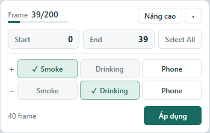

# CVAT Event Hotkeys

Extension Chrome dành cho `cvat-tai.abcstudio.online`. Khi mở hoặc tải lại một job đang ở **Standard**, extension tự chuyển sang **Tag annotation** rồi gán các phím nếu nhãn tương ứng có trong job. Nếu bạn chuyển lại **Standard** để vẽ box, extension giữ lựa chọn đó cho đến khi bạn mở job khác hoặc tải lại trang.

| Phím | Nhãn |
| --- | --- |
| 1 | `event_smoke` |
| 2 | `event_drinking` |
| 3 | `event_phone` |

Bấm một lần để gắn tag vào frame hiện tại. Bấm lại để gỡ. Lưu annotation bằng **Save** của CVAT.

## Chỉnh tag theo khoảng frame

Bảng chỉnh nhanh nằm ngay dưới ô số frame khi mở job. **Frame 0/200** là vị trí trong job tính từ 0 trên tổng số frame của job. Chọn frame đầu rồi bấm **Start** (phím `4`), chọn frame cuối rồi bấm **End** (phím `5`). Hai mốc hiển thị số frame của CVAT. Thanh tiến độ tô xanh cả hai đầu của khoảng. Có thể đặt End trước Start. Bấm **Select All** cạnh End hoặc nhấn **Ctrl+A** trong Tag annotation để đặt cả hai mốc từ frame đầu đến frame cuối của job. Sau đó chọn event và bấm **Áp dụng** khi sẵn sàng.

- Hàng **+** thêm event vào những frame hợp lệ còn thiếu. Hàng **−** xóa event ở những frame có tag, kể cả frame 0. Mỗi hàng có ba nút theo thứ tự Smoke, Drinking, Phone. Nhãn thiếu trong job được gạch ngang.
- Bấm một nút để chọn, bấm lại để bỏ chọn. Nút đang chọn có dấu tích và khóa cùng event ở hàng đối diện. Có thể chọn nhiều event trên cả hai hàng rồi bấm **Áp dụng** một lần.
- **Áp dụng** chỉ sáng khi có thay đổi trong khoảng. Sau khi áp dụng, sáu nút trở về trạng thái ban đầu và hai mốc được giữ lại. Nếu dữ liệu vừa thay đổi, bảng giữ lựa chọn và yêu cầu xem lại trước khi bấm lần nữa. Đổi khoảng khi còn lựa chọn sẽ hỏi trước khi bỏ bản nháp.
- **Alt+1/2/3** chọn hoặc bỏ chọn ở hàng thêm. **Alt+Shift+1/2/3** điều khiển hàng xóa. **Enter** áp dụng khi đang thao tác trên canvas. Khi dùng Tab để di chuyển tới một nút, Enter hoặc Space kích hoạt nút đó. Nút **▴** thu gọn bảng, phím `4` và `5` vẫn đặt mốc.
- Tổng số tag của từng event trong job nằm dưới **Complete & Next** và **Clear All Tags**. Số đếm hiện ngay khi mở job và tính cả thay đổi chưa lưu.
- Cặp nút `+` và `−` cạnh mỗi số đếm áp dụng cho toàn bộ job đang mở. `+` thêm nhãn vào frame hợp lệ còn thiếu. `−` hiện số tag cần xóa và yêu cầu xác nhận. Hai nút dùng được khi chưa đặt Start/End.
- **Undo** và **Redo** bên dưới số đếm hoàn tác hoặc làm lại một lần Apply của extension, từ nút toàn job, Start/End hoặc Nâng cao. Lịch sử nằm trong phiên job hiện tại. Nếu tag liên quan vừa được chỉnh bằng thao tác khác, extension hiện thông báo và giữ dữ liệu hiện tại.

Phím của bảng chỉ có tác dụng trong **Tag annotation** của job đang mở, khi không gõ trong ô nhập, không mở dropdown hay hộp thoại. Khi bảng nhận `4`/`5`, CVAT không gắn tag slot 4/5. Các phím `1/2/3`, điều hướng frame, Save và Undo/Redo vẫn của CVAT. Chrome trên Windows giữ `Ctrl+1…8` để chuyển tab, vì vậy bảng dùng `Alt+1/2/3`.

**Nâng cao** mở hộp thoại cho **Đổi tag** và **Xóa toàn bộ tag trong khoảng**, cùng **Thêm event** và **Xóa tag đã chọn**. Hộp thoại bắt đầu bằng các lựa chọn từ bảng nhanh, gộp theo hàng thêm và hàng xóa, rồi thêm một thẻ **Đổi tag** mới. Bấm **+ Thêm thao tác** để thêm thẻ. Đầu hộp thoại hiện số tag của ba event trong khoảng. Thẻ không hợp lệ được tô đỏ kèm lý do và khóa **Áp dụng**. **Hủy** hoặc Esc giữ lựa chọn ở bảng. **Áp dụng** chạy toàn bộ và xóa bản nháp khi thành công.

- **Đổi tag** chọn một tag nguồn (kể cả nhãn ngoài ba event) và một event đích. Nếu frame đã có cả hai, extension giữ tag đích và gỡ tag nguồn.
- **Xóa toàn bộ tag trong khoảng** áp dụng cho tất cả các nhãn tag trong hai mốc.
- **Thêm event** chỉ thêm vào các frame hợp lệ còn thiếu event đó; xóa rồi thêm lại cùng một tag không tính là thay đổi.

Extension sửa tag ngay trên trình duyệt, giống như khi bạn gắn tag bằng tay. Trang không tải lại và bạn vẫn ở frame hiện tại. Sau khi áp dụng, Start và End vẫn giữ nguyên và vẫn tô xanh, nên có thể chỉnh tiếp ngay cho cùng khoảng. Muốn đổi khoảng thì bấm Start hoặc End ở frame khác. Start và End chỉ bị xóa sau Complete & Next. Nếu có lỗi, các lựa chọn được giữ lại để thử lại. Nếu tag trong khoảng vừa thay đổi sau lần đọc gần nhất, extension không áp dụng mà làm mới dữ liệu và yêu cầu xem lại.

Extension chỉ đọc các frame trong khoảng đã đánh dấu, ngay trên trình duyệt, và nhớ lại kết quả theo từng frame. Khoảng mới chồng lên khoảng cũ chỉ phải đọc thêm các frame mới; chuyển frame không làm mất phần đã nhớ. Khi bạn gắn, gỡ tag hoặc Undo, khoảng đang đánh dấu được đọc lại để số liệu trên bảng luôn đúng. Sau khi Complete & Next, extension xóa phần đã nhớ cùng Start/End của job.

Thay đổi được lưu lên server ở lần lưu tiếp theo của CVAT: theo **Auto save** trong Settings, khi bấm **Save** (Ctrl+S), hoặc khi bấm **Complete & Next**. Dòng trạng thái cạnh Complete & Next cho biết thay đổi đã lưu chưa.

## Hoàn tất rồi mở job tiếp theo

Bấm **Complete & Next** cạnh **Menu**. Extension làm lần lượt, bước sau chỉ bắt đầu khi bước trước đã xong:

1. **Save:** nếu còn thay đổi chưa lưu, bấm **Save** của CVAT và đợi CVAT lưu xong. Không có gì để lưu thì bỏ qua.
2. **Completed:** chuyển job sang **Completed** giống lệnh Finish the job của CVAT, rồi hỏi lại server để chắc chắn.
3. **Next:** mở job tiếp theo.

 Extension mở job chưa hoàn tất (New, In progress, Rejected) có ID lớn hơn gần nhất được giao cho bạn trong cùng task. Nếu chỉ còn job có ID nhỏ hơn, extension quay về job chưa hoàn tất có ID nhỏ nhất của bạn. Khi không còn job nào phù hợp, extension mở trang task. Server tự lọc theo task, người được giao, trạng thái và ID, nên thường extension chỉ hỏi đúng một job mỗi lần. Nếu bộ lọc không tìm thấy job nào, extension đọc danh sách job của task như các bản trước để chắc chắn không bỏ sót.

Nút yêu cầu job hiện tại được giao cho tài khoản đang đăng nhập. Nếu CVAT báo lỗi hoặc chưa xác nhận hoàn tất, bạn vẫn ở job hiện tại.

## Xóa toàn bộ tag của job hiện tại

Nút **Clear All Tags** hiện số tag của job, gồm cả thay đổi chưa lưu, và tự cập nhật sau mỗi lần gắn, gỡ tag, Undo, Áp dụng hay xóa. Bấm nút để xem lại số tag, rồi bấm **Xóa toàn bộ tag** để xóa tag ở mọi frame ngay trên trình duyệt.

Việc xóa đi cùng đường với **Áp dụng** của phần chỉnh theo khoảng: trang không tải lại, bạn vẫn ở frame hiện tại, Start/End và các lựa chọn ở bảng được giữ và tính lại theo dữ liệu mới. Box, shape và track vẫn giữ nguyên. CVAT lưu việc xóa ở lần lưu tiếp theo (Auto save, Save hoặc Complete & Next); dòng trạng thái cho biết đã lưu chưa. Trước khi lưu, có thể Undo (Ctrl+Z, mỗi lần một tag). Nếu tag của job thay đổi sau khi mở hộp thoại, extension không xóa mà hiện số mới để bạn kiểm tra lại.

## Tải lên server

Extension được thiết kế để không làm server CVAT quá tải:

| Thao tác | Request extension gửi |
| --- | --- |
| Phím 1/2/3, Start, End, phím của bảng chỉnh nhanh | Không có |
| Bảng chỉnh nhanh, Nâng cao: đọc, xem trước và áp dụng | Không có: đọc và sửa annotation CVAT đã tải sẵn trên trình duyệt |
| Clear All Tags (đếm và xóa) | Không có |
| Lưu (Auto save, Save, Complete & Next) | CVAT tự gửi, chỉ gồm các tag đã đổi: tối đa 1 request cho tag sửa, 1 cho tag xóa, 1 cho tag mới |
| Complete & Next | Ngoài phần lưu của CVAT: 1 GET kiểm tra job đã Completed, rồi 1–2 GET tìm job tiếp theo (`page_size=1`) |

Các GET của extension đi lần lượt, cách nhau ít nhất 250 ms. Nếu server trả 429, 502, 503 hoặc 504, extension đợi rồi thử lại tối đa hai lần và tôn trọng `Retry-After`.

## Cài trên Chrome

1. Tải `cvat-event-hotkeys-vX.Y.Z.zip` mới nhất ở [GitHub Releases](https://github.com/thunguyen-abc/cvat-hotkey/releases/latest). Giải nén vào một thư mục cố định, ví dụ `C:\Users\<tên bạn>\cvat-event-hotkeys`. Không để trong Downloads hay thư mục tạm.
2. Mở `chrome://extensions` trong Chrome và bật **Developer mode**. Giữ chế độ này luôn bật. Nếu tắt, Chrome sẽ vô hiệu hóa extension ở lần tải lại tiếp theo.
3. Chọn **Load unpacked**, rồi chọn thư mục vừa giải nén (thư mục chứa `manifest.json`).
4. Tải lại tab CVAT hoặc mở một job. Kiểm tra **Tag annotation** và ba dòng đầu ở **Shortcuts for labels**.
5. Nên làm: bật trình cập nhật tự động theo hướng dẫn ở mục dưới.

## Cập nhật tự động (Windows)

Chrome không tự cập nhật extension cài bằng **Load unpacked**. Thư mục `updater` trong ZIP có một trình cập nhật chạy trên máy bạn:

1. Mở thư mục extension, vào `updater`, nhấp đúp **`Setup-Updater.cmd`**.
2. Đọc phần mô tả và xác nhận thư mục extension. Nhấn Enter để dùng thư mục được gợi ý.
3. Chọn chế độ:
   - **1. Tự động**: tải và cài bản mới ngay khi GitHub có release.
   - **2. Hỏi trước** (mặc định): hiện hộp thoại Windows, chỉ cài khi bạn bấm **Yes**. Nếu bấm **No**, lần kiểm tra sau sẽ hỏi lại.
4. Gõ `y` để đồng ý. Trình cập nhật tạo lịch chạy mỗi khi đăng nhập Windows và mỗi 3 giờ, rồi kiểm tra ngay một lần.

Từ đó, khi có bản mới, mở biểu tượng **CVAT Event Hotkeys** trong Chrome và bấm **Cập nhật ngay**. Trình cập nhật tải, kiểm tra và cài bản mới, rồi extension tự kích hoạt. Không mở GitHub, không giải nén, không bấm Reload. Thường mất vài giây; có thể đóng cửa sổ trong lúc cài. Ngoài nút này, trình cập nhật vẫn tự kiểm tra theo lịch.

Sau khi cài file mới (bằng nút hoặc theo lịch), extension tự kích hoạt bản mới trong khoảng 1 phút, hoặc ngay khi bạn mở cửa sổ extension. Bạn không cần bấm **Reload** trong `chrome://extensions`. Tải lại tab CVAT đang mở để dùng bản mới. Annotation chưa lưu trong tab không bị ảnh hưởng.

Ở cả hai chế độ, trình cập nhật luôn hỏi lại nếu bản mới xin thêm quyền Chrome hoặc thêm trang web. Trình cập nhật không cần quyền Administrator.

Các lệnh khác: chạy `Setup-Updater.cmd <lệnh>` trong thư mục `updater`.

| Lệnh | Tác dụng |
| --- | --- |
| `status` | Xem chế độ, lần kiểm tra cuối, lịch chạy và nhật ký |
| `check` | Kiểm tra và cài bản mới ngay |
| `setup` | Chạy lại thiết lập để đổi chế độ hoặc thư mục |
| `rollback` | Quay về bản trước. Bản vừa gỡ sẽ không tự cài lại. |
| `uninstall` | Gỡ lịch chạy và dữ liệu của trình cập nhật. Extension vẫn giữ nguyên. |

Chi tiết cách hoạt động, kiểm tra bảo mật và xử lý lỗi: [docs/auto-update.md](docs/auto-update.md).

## Cập nhật thủ công

Mở biểu tượng **CVAT Event Hotkeys** trong Chrome. Extension kiểm tra [GitHub Releases](https://github.com/thunguyen-abc/cvat-hotkey/releases/latest) khi mở cửa sổ này và định kỳ mỗi sáu giờ. Khi có bản mới, biểu tượng hiện **NEW**. Nếu máy đã cài trình cập nhật, cửa sổ hiện nút **Cập nhật ngay** (xem mục trên). Nếu chưa, nút **Update** tải ZIP phát hành: giải nén đè vào thư mục đang dùng, bấm **Reload** trong `chrome://extensions`, rồi tải lại CVAT. Cửa sổ này cũng cho biết máy đã cài trình cập nhật tự động chưa và lần kiểm tra cuối.

## Phát hành phiên bản mới

1. Cập nhật `version` trong `manifest.json`, ví dụ `1.5.2`.
2. Push commit lên `main`, rồi push tag tương ứng: `git tag v1.5.2`, `git push origin v1.5.2`.
3. GitHub Actions kiểm tra cú pháp, đóng gói ZIP (gồm cả thư mục `updater`), tạo file `.sha256` và đăng cả hai lên Releases.

Sau khi release xuất hiện, các máy đã bật trình cập nhật sẽ nhận bản mới trong vòng 3 giờ, hoặc ở lần đăng nhập Windows tiếp theo. Vì vậy, ai có quyền push tag vào repository này đều có thể đưa mã mới lên máy của mọi người dùng. Xem khuyến nghị ở [docs/auto-update.md](docs/auto-update.md#bảo-vệ-repository).

Tài liệu cho người phát triển: [docs/development.md](docs/development.md).

## Quyền và dữ liệu

Extension dùng giao diện CVAT để gắn, gỡ và lưu annotation khi bạn thao tác. Nút Complete & Next dùng phiên đăng nhập hiện tại để đọc thông tin tài khoản và danh sách job từ API trên cùng tên miền CVAT. Ngoài CVAT, extension chỉ gọi `api.github.com` để kiểm tra phiên bản mới.
